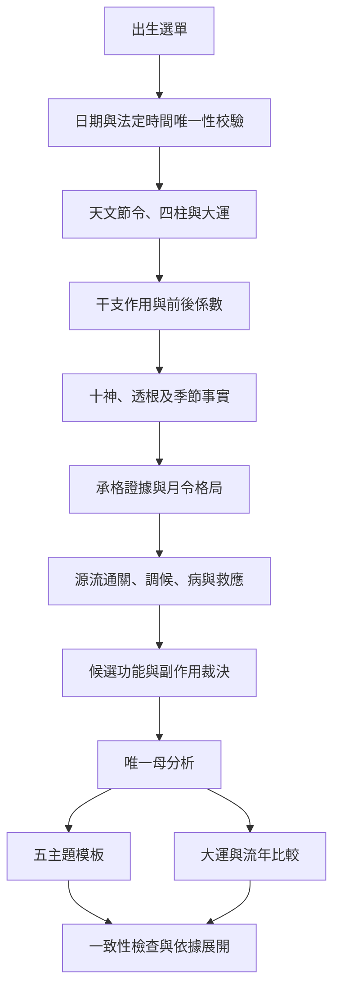

# 架構與資料契約

## 執行順序



`calendar/` 不引用命局規則。`engine/` 不操作 DOM，不查詢網路、不使用隨機數或執行時當下日期。`report/` 使用母分析與條件式模板；`ui/` 只負責呈現。介面預設流年固定 2026，並非用當前年份改動本命結果。

## 主要介面

```js
import { calculate } from './src/calendar/chart.js';
import { analyze } from './src/engine/analyze.js';
import { buildReports } from './src/report/build.js';
import { annualReport } from './src/engine/periods.js';

const chart = calculate({
  sex: '男',
  year: 1990,
  month: 6,
  day: 1,
  hour: 12,
  minute: 0,
  location: 'tw-0',
});
const mother = analyze(chart);
const report = buildReports(mother);
const annual = annualReport(mother, 2026);
```

`calculate` 會丟出可展示的錯誤：無效日期、超出支援年代、出生地未列入、不存在或重複法定時間。使用者沒有額外命理問卷輸入。

### Chart

| 欄位         | 內容                                                          |
| ------------ | ------------------------------------------------------------- |
| `birth`      | 唯一有效 UTC 毫秒、當地出生資料、地點、IANA zone、實際 offset |
| `pillars`    | 年月日時，干索引、支索引、六十甲子索引、十神、藏干            |
| `adjacent`   | 前後「節」的名稱、黃經、UTC 毫秒、類型                        |
| `startLuck`  | 順逆、目標節、距離日數、起運年／月／日／秒與交運 UTC          |
| `luck`       | 十步大運，干支及左含右不含時間區間                            |
| `versions`   | 排盤、解讀、模板、天文套件及 tzdb 版本                        |
| `validation` | 已完成的日期、地點、法定時間及節令檢查                        |

### Mother analysis

| 欄位        | 內容                                                   |
| ----------- | ------------------------------------------------------ |
| `action`    | 作用參與柱位、受作用柱位、作用前後係數、規則 trace     |
| `facts`     | 個別透藏項目、十神聚合、五行聚合、根與季節             |
| `strength`  | 支持、負荷、得令係數、比值、支持與反對證據             |
| `patterns`  | 月令候選、月令發用、五組合候選、主結構、所需相神       |
| `flow`      | 主源、相生路徑、相剋阻隔、中介通關、清濁、真假         |
| `climate`   | 日干×月支索引、寒暖燥濕、全局火水與候選承接            |
| `diagnosis` | 觸發的病、嚴重度、主病、逐病救應及副作用               |
| `use`       | 五行功能、分數、先決條件、角色、風險及順位             |
| `mainline`  | 由母分析統一生成的人生核心主線                         |
| `id`        | 出生欄位與完整版本組合的穩定 FNV-1a 識別碼，非安全憑證 |

個別干支作用會改變季節權重後的力量。`before` 是該項目的基準，`force` 為套用係數及根氣後的力；天干存在根氣加成時 `force` 可大於 `before`。作用事件另外保存連續相乘前後的係數，兩者不可混用。

### 規則 trace

```js
{
  rule: 'PAT-02',
  version: 'mbas-1.0.0',
  passed: false,
  condition: '版本化成立條件',
  exclusion: '版本化排除條件',
  facts: ['真實柱位與十神作用力', '相鄰承接=false'],
  decision: '位置無承接，待條件',
}
```

`passed: false` 仍是有價值的排除結果，不是排盤失敗。規則未觸發與命盤中不存在某事不同。空白力量以零與所查十神名稱明列，不能留下空的「依據」。

### 歲運分層

`periodImpact` 建立加入大運／流年干支後的比較事實，重新計算作用力及期間承格，輸出 `changes`、`natalChanges`、`periodCapacity`、`priority`、最多三個情境與 trace。原本 `mother.use` 與 `mother.strength` 不變。

`annualReport` 先求年立春與次年立春，截取出生起點，再把所有交運時刻放入區間切點。每段使用其實際大運。尚未起運或超出十步大運時不假借第一步，介面會明示。

### 報告

每頁有 `analysisId`、`structureId`、`diseaseId`、`useSummary`、`mainline` 及 `cards`。每張卡有結論、具體情境、形成原因、成立條件及 trace。輸出前校驗五頁參照一致性與依據完整性。

列印產生臨時的完整五頁主題 DOM，展開全部 trace，列印結束後移除。這個「五頁」是五個主題，實際紙張會依內容自然分頁。JSON export 使用明訂 schema，函式自然略過序列化，不帶 DOM 或工作階段存取物件。

## 規則更新策略

1. 說明欲修正的盤面案例，建立正例與相近反例。
2. 修改對應 `engine/` 模組及 `data/rules.js` 的成立／排除條件。
3. 若改變裁決結果，更新規則版本；排盤慣例變更則另增排盤版本。
4. 增補測試並檢查五頁一致性、歲運不改寫本命。
5. 更新 `docs/RULES.md`、README 範圍及驗證紀錄。
6. `npm run check` 通過後交付或推送部署。

時區更新須由鎖定版本的依賴擷取，保留完整歷史；不可改用僅含前後數年的時區 bundle。日干、干支、地點、規則 ID 等排序以固定陣列／數值決定，不以使用者語系的排序作裁決依據。
